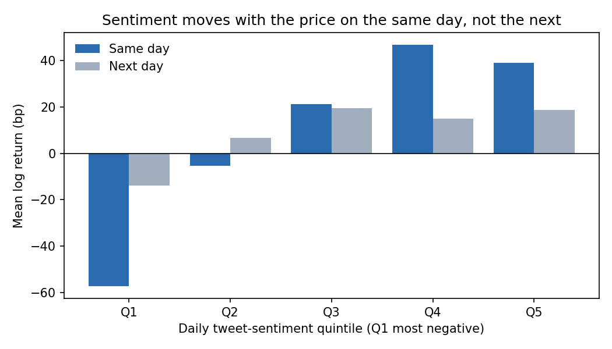
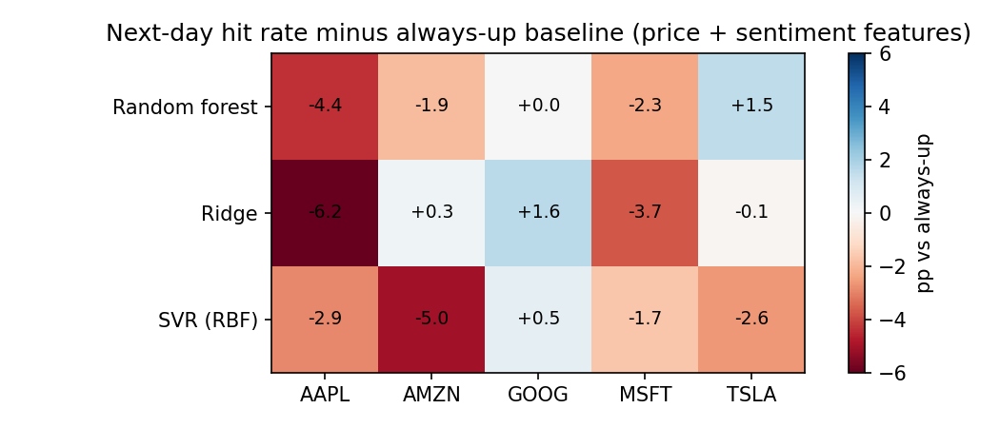
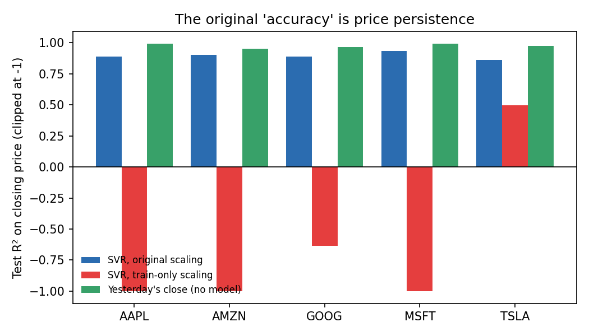

# Does Twitter Sentiment Predict Stock Returns?

VADER sentiment on ~2.5 million non-neutral tweets about Apple, Amazon, Google, Microsoft and Tesla (2015–2019), joined to daily prices and tested with support vector regression, random forests and linear baselines under **walk-forward, look-ahead-free** evaluation.

**Key findings**
1. **Sentiment tracks same-day returns.** Daily tweet sentiment correlates with that day's return for all five stocks (r = 0.11 to 0.21, p ≤ 1e-4). The most negative sentiment quintile averages −57 bp on the day; the top two quintiles average +39 to +47 bp.
2. **It does not reliably predict the next day.** No model, with or without sentiment features, beats the "always predict up" baseline on next-day direction once evaluated out of sample (best average hit rate 53.4% vs 54.3% for always-up).
3. **The earlier 86–91% "accuracy" was price persistence.** The original version scored R² on the price *level*, using the last three closes as inputs. Simply predicting yesterday's close scores R² 0.95 to 0.99, higher than any model. With scalers fit on training data only, as they must be, the models' R² turns negative for four of five stocks.



## Results

All numbers come from `python scripts/run_experiments.py` (about 5 minutes on a laptop). Test period: February 2017 to December 2019 (~730 trading days per stock), models refit every quarter on an expanding window.

### 1. Sentiment vs returns

| Stock | Corr. with same-day return | Corr. with next-day return | Granger p, sentiment → returns | Granger p, returns → sentiment |
|---|---|---|---|---|
| AAPL | **0.165** (p<1e-4) | 0.030 (p=0.28) | 0.067 | **0.001** |
| AMZN | **0.188** (p<1e-4) | **0.091** (p=0.001) | **0.002** | **0.031** |
| GOOG | **0.110** (p=1e-4) | 0.054 (p=0.06) | **0.041** | **0.001** |
| MSFT | **0.135** (p<1e-4) | 0.050 (p=0.07) | **0.0002** | 0.058 |
| TSLA | **0.209** (p<1e-4) | 0.050 (p=0.08) | **0.045** | 0.197 |

Granger p-values are the smallest SSR F-test p-value over lags 1 to 5. The link runs both ways: returns feed back into sentiment for Apple and Google, while Amazon shows the strongest forward signal (next-day correlation 0.09).

### 2. Next-day forecasts (averaged over the five stocks)

| Features | Model | Hit rate | vs always-up | Out-of-sample R² | Rank IC |
|---|---|---|---|---|---|
| none | Historical mean (always up) | 54.3% | n/a | 0 | n/a |
| price | Ridge | 53.4% | −0.9 pp | −0.4% | 0.022 |
| price | SVR (RBF) | 52.2% | −2.1 pp | −4.5% | 0.001 |
| price | Random forest | 53.0% | −1.3 pp | −1.3% | −0.005 |
| sentiment | Ridge | 52.0% | −2.3 pp | −0.4% | 0.029 |
| sentiment | SVR (RBF) | 52.7% | −1.6 pp | −3.1% | 0.035 |
| sentiment | Random forest | 52.3% | −2.0 pp | −0.6% | 0.022 |
| price + sentiment | Ridge | 52.7% | −1.6 pp | −0.4% | 0.034 |
| price + sentiment | SVR (RBF) | 52.0% | −2.3 pp | −4.0% | 0.026 |
| price + sentiment | Random forest | 52.9% | −1.4 pp | −0.6% | 0.018 |

Sentiment features nudge the rank IC up (0.018–0.035, vs ≈0 for the nonlinear price-only models), but the effect is too small to turn into better directional calls. Per-stock tables are in [`results/summary.md`](results/summary.md); Microsoft is the one stock where price + sentiment models reach a positive out-of-sample R² (+2.5% Ridge, +2.2% random forest).



### 3. Re-running the original price-level setup

| Stock | SVR, scalers as originally fit | Random forest, as originally fit | SVR, train-only scaling | Yesterday's close |
|---|---|---|---|---|
| AAPL | 0.891 | 0.866 | −2.07 | **0.991** |
| AMZN | 0.902 | 0.825 | −1.25 | **0.954** |
| GOOG | 0.888 | 0.824 | −0.64 | **0.967** |
| MSFT | 0.935 | 0.865 | −7.15 | **0.992** |
| TSLA | 0.864 | 0.842 | 0.50 | **0.973** |



Two things inflated the original scores: the test-set scaler was fit on the test set itself (so it knew the future price range), and R² on a trending price level is dominated by yesterday's price. Tree and kernel models also can't extrapolate beyond the training price range, which is why train-only scaling collapses on 2018–2019 prices.

## Method

**Data.** Tweets mentioning $AAPL, $AMZN, $GOOG/$GOOGL, $MSFT and $TSLA from the Kaggle dataset *Tweets about the Top Companies from 2015 to 2020*, with daily prices from the same dataset.

**Sentiment.** Each tweet gets a VADER compound score in [−1, 1]. VADER is a lexicon and rule-based model built for social media text (it handles emoji, capitalisation and intensifiers), which suits short tweets better than a general-purpose classifier. Neutral tweets (score exactly 0) are dropped. Each tweet also gets a trend score, 1 + comments + retweets + likes, as a measure of attention.

**Daily panel.** Per stock and day: closing price, summed trend score, mean sentiment. Days when NYSE is closed (weekends and holidays) are folded into the next trading day, with sentiment weighted by trend score: tweets from Saturday are information available before Monday's open. Tweets are dated in UTC, so a day's tweets close out before the next US session opens.

**Features at the close of day t** (all trailing):
- *price*: returns at lags 0 to 4, 5-day momentum, 5-day volatility
- *sentiment*: sentiment at lags 0 to 2, change in sentiment, 20-day z-score of sentiment, log attention and its 20-day z-score

**Target.** Log return of day t+1.

**Models.** Ridge, SVR (RBF kernel) and random forest, each in a scikit-learn pipeline whose feature and target scalers are fit on training data only. The benchmark is the historical-mean forecast, which predicts "up" in this bull-market sample.

**Evaluation.** Expanding-window walk-forward: first fit on February 2015 to January 2017 (504 trading days), then refit every 63 days and predict the next block. Metrics: directional hit rate (days with a nonzero move), out-of-sample R² relative to the historical mean (Campbell–Thompson), Spearman rank IC, and a pooled one-sided binomial test of hit rate against the always-up rate.

**Tests** (`pytest`) check the holiday calendar against the price feed, the weekend folding, that features only use past data (perturbing the future leaves today's features unchanged), that the target is the next day's return, and that walk-forward never trains on the block it predicts.

## Run it

```bash
python -m venv .venv
.venv/Scripts/activate        # Windows; use `source .venv/bin/activate` on macOS/Linux
pip install -e ".[dev]"
python scripts/run_experiments.py           # all tables and figures -> results/
python scripts/run_experiments.py --quick   # 2 stocks, fast smoke run
pytest
```

The daily panels in `data/processed/` are included, so the experiments run without the raw tweets. To rebuild them from scratch, download the Kaggle dataset into `data/raw/` and run `pip install -e ".[prepare]"` then `python scripts/prepare_data.py` (VADER over ~4M tweets, 20–30 minutes).

## Project structure

```
src/tweetsent/
  data.py          load daily panels, NYSE calendar, fold non-trading days, next-day target
  features.py      trailing price and sentiment features
  models.py        Ridge / SVR / random forest pipelines, historical-mean benchmark
  evaluation.py    walk-forward loop, hit rate, out-of-sample R², rank IC, binomial test
  stats_tests.py   correlations, Granger causality, returns by sentiment quintile
  replication.py   the original price-level setup and its corrected variants
scripts/
  prepare_data.py      raw tweets -> daily panels (VADER)
  run_experiments.py   every table and figure in this README
data/processed/    daily panels per company
results/           generated tables (CSV, Markdown) and figures
tests/
```

## References
- C. J. Hutto and E. Gilbert, "VADER: A Parsimonious Rule-based Model for Sentiment Analysis of Social Media Text", *ICWSM*, 2014.
- J. Bollen, H. Mao and X. Zeng, "Twitter mood predicts the stock market", *Journal of Computational Science*, 2011.
- J. Y. Campbell and S. B. Thompson, "Predicting Excess Stock Returns Out of Sample", *Review of Financial Studies*, 2008.
- C. W. J. Granger, "Investigating Causal Relations by Econometric Models and Cross-spectral Methods", *Econometrica*, 1969.
